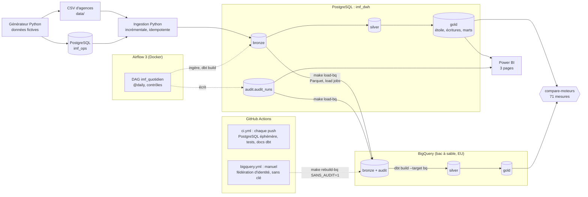

# SenFinance Microcrédit – pipeline de données & états financiers


> **EN —** End-to-end ELT pipeline for a fictional Senegalese microfinance institution: synthetic
> operations → PostgreSQL → dbt (bronze / silver / gold) → star schema, double-entry bookkeeping,
> monthly trial balances, financial statements and loan-portfolio KPIs (PAR 30), orchestrated by
> Airflow and shown in a Power BI dashboard. The same dbt project also runs on BigQuery, with an
> automated engine-to-engine comparison (0 difference).

[](https://github.com/NdeyePendaSarr/imf-data-pipeline/actions/workflows/ci.yml)
[](https://github.com/NdeyePendaSarr/imf-data-pipeline/actions/workflows/bigquery.yml)
[](https://ndeyependasarr.github.io/imf-data-pipeline/)

SenFinance Microcrédit est une institution de microfinance **fictive**, présente dans cinq régions
du Sénégal. Le pipeline transforme ses opérations brutes (dépôts, retraits, crédits,
remboursements, charges) en indicateurs de pilotage du portefeuille, en comptabilité en partie
double (balances, compte de résultat, bilan simplifié, logique SYSCOHADA) et en contrôles
automatiques. Tout est reconstruit d'une commande, testé à chaque push et vérifié sur deux moteurs.

## Résultats

Exercice 2025, données générées (2 000 clients, 3 000 crédits), arrêté au 31/12/2025 :

| Contrôle | Résultat |
|---|---|
| Bilan | actif = passif = **2 119 584 054 XOF**, équilibré chaque fin de mois |
| Résultat de l'exercice | **−333 130 376 XOF** (164 015 389 de produits, 497 145 765 de charges) |
| Portefeuille à risque à 30 jours (PAR 30) | 92 511 316 / 1 850 520 623 XOF = **4,9992 %**, égal à la vérité du générateur |
| Rapprochements gestion ↔ comptabilité | 120 contrôles (12 mois × 5 agences × dépôts et crédits), **écart 0** partout |
| Écritures comptables | 84 572 pièces, 181 193 lignes, chaque pièce équilibrée, aucun événement rejeté |
| Orchestration (Airflow) | exercice rejoué jour par jour : **365 runs réussis**, 0 échec, 3 h 27 |
| PostgreSQL ↔ BigQuery | même projet dbt sur les deux moteurs : **71 mesures comparées, 0 écart** |
| Tests | 457 nœuds dbt verts sur chaque moteur (dont 388 tests de données) ; 227 tests pytest |
| CI à chaque push | [job principal **109 s** + **26 s** de publication des docs dbt](https://github.com/NdeyePendaSarr/imf-data-pipeline/actions/runs/45399031578) |
| Job BigQuery (manuel) | [**351 s**, sans clé de service](https://github.com/NdeyePendaSarr/imf-data-pipeline/actions/runs/45396166776) |

## Architecture



**Stack** : Python 3.12 (uv, ruff, mypy, pytest) · PostgreSQL 17 · Docker Compose · dbt Core 1.12
(PostgreSQL et BigQuery) · Apache Airflow 3.3 · Power BI Desktop · Google BigQuery · GitHub Actions.

## Démarrage rapide

Prérequis : Docker, [uv](https://docs.astral.sh/uv/), make (sous Windows : WSL2 et Docker Desktop).

```bash
git clone https://github.com/NdeyePendaSarr/imf-data-pipeline.git
cd imf-data-pipeline
cp .env.example .env   # puis choisis les mots de passe dans .env
make install           # environnement Python
make up                # démarre PostgreSQL (port 5433)
make generate          # génère les données et remplit imf_ops
make ingest-all        # ingère tout l'exercice dans le bronze
make dbt-build         # silver et gold : seeds, modèles et tests dbt
make check             # lint, types, dbt build et tous les tests
```

Aller plus loin : `make airflow-up` (orchestration), `make powerbi-role` (lecture Power BI),
`make rebuild-bq` (BigQuery). `make help` liste toutes les commandes.

## BigQuery et CI en bref

- **Deux workflows.** [`ci.yml`](.github/workflows/ci.yml) reconstruit tout sur un PostgreSQL
  éphémère à chaque push et pull request, lance les tests et publie la documentation dbt ;
  [`bigquery.yml`](.github/workflows/bigquery.yml), lancé à la main, reconstruit l'entrepôt dans
  BigQuery et compare les deux moteurs.
- **Le même projet dbt sur deux moteurs.** Les écarts de SQL entre PostgreSQL et BigQuery passent
  par du SQL standard, des macros dbt, puis huit macros maison testées sur les deux moteurs. Une
  comparaison versionnée (`make compare-moteurs`) échoue au moindre écart.
- **Sans clé de service.** En CI, GitHub obtient l'identité Google par fédération d'identité,
  limitée à ce dépôt et à la branche `main` ; aucun secret n'est stocké.
- **Bac à sable gratuit.** Pas de facturation, donc pas de Cloud Storage : le bronze est chargé
  directement depuis PostgreSQL. Les tables expirent au bout de 60 jours ; `make rebuild-bq`
  recrée l'entrepôt en ≈ 4 min 30.

Détails, chiffres et inventaire du portage : [docs/phases.md](docs/phases.md#bigquery-et-intégration-continue-phase-9)
et [docs/phase9/inventaire_bq.md](docs/phase9/inventaire_bq.md).

## Limites

- Données **100 % fictives** ; l'IMF est supposée en première année d'activité.
- **Résultat de l'exercice : −333 130 376 XOF** (produits 164 015 389, charges 497 145 765), pour un bilan de 2 119 584 054. Il vient de la construction des données : portefeuille constitué en cours d'année (aucun crédit en janvier, encours de 1,85 milliard atteint seulement en fin d'exercice), intérêts reconnus à l'encaissement, charges courant sur 12 mois. Ce déficit n'est pas représentatif d'une IMF réelle : le générateur privilégie la couverture des cas de test au réalisme du compte de résultat.
- Plan de comptes **simplifié**, à codes internes : ce n'est pas le référentiel comptable officiel
  des systèmes financiers décentralisés (RCSFD) ; les correspondances avec le SYSCOHADA sont
  **indicatives**.
- Intérêts constatés à l'encaissement, pas de provisions sur créances en souffrance, épargne non
  rémunérée, pas d'écriture de clôture.
- Pas de comptes de tiers par agent : les comptes de liaison sont classés sur leur solde au niveau
  de l'IMF (écart chiffré sur la liaison agents : 9 590 935 XOF au 31/12/2025).
- La base opérationnelle simulée ne garde que l'état au 31/12 ; le statut des crédits à une date
  passée est recalculé dans l'entrepôt.
- BigQuery dans un bac à sable : pas de Cloud Storage, données supprimées au bout de 60 jours,
  pas de requêtes de modification ; Airflow n'orchestre que PostgreSQL.
- Liste complète : [PRD, limites](docs/cadrage/PRD_pipeline_IMF_SYSCOHADA.md#12-limites-à-afficher-dans-le-readme).

## Documentation

| Document | Contenu |
|---|---|
| [docs/phases.md](docs/phases.md) | le projet phase par phase : commandes, choix, chiffres, démonstrations de pannes |
| [Documentation dbt](https://ndeyependasarr.github.io/imf-data-pipeline/) | modèles, colonnes, tests et graphe de lignage |
| [dashboard/](dashboard/) | `.pbix`, [captures](dashboard/captures/), [mesures DAX](dashboard/mesures.md), [modèle de données](dashboard/modele_donnees.md) |
| [docs/cadrage/](docs/cadrage/README.md) | cahier des charges (PRD) et cadrage de chaque phase, avec les décisions numérotées |
| [docs/phase9/inventaire_bq.md](docs/phase9/inventaire_bq.md) | compatibilité PostgreSQL / BigQuery, cas par cas |

## Licence

MIT — voir [LICENSE](LICENSE).

## Autrice

**Ndeye Penda SARR** — Master 2 Business Intelligence (UCAD) · Data Engineering (Orange Digital Center)
