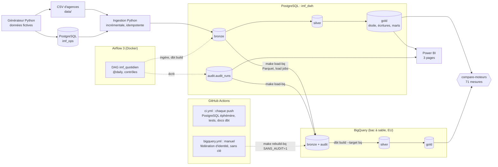
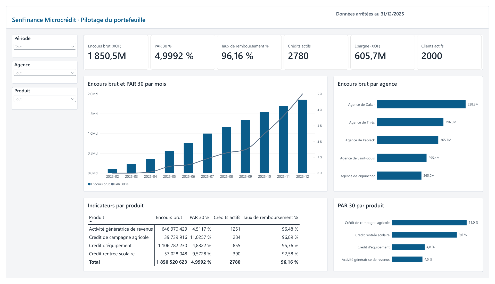
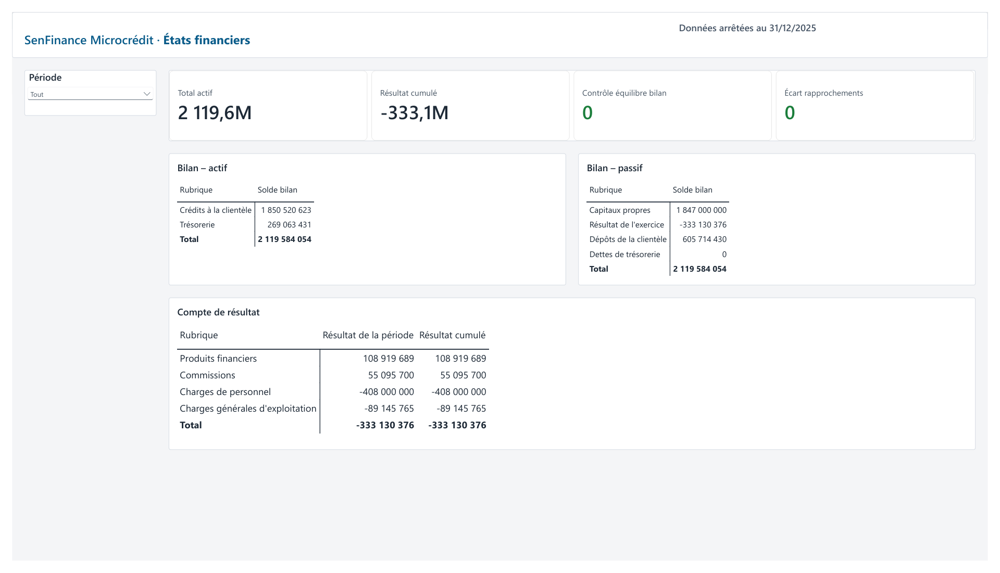
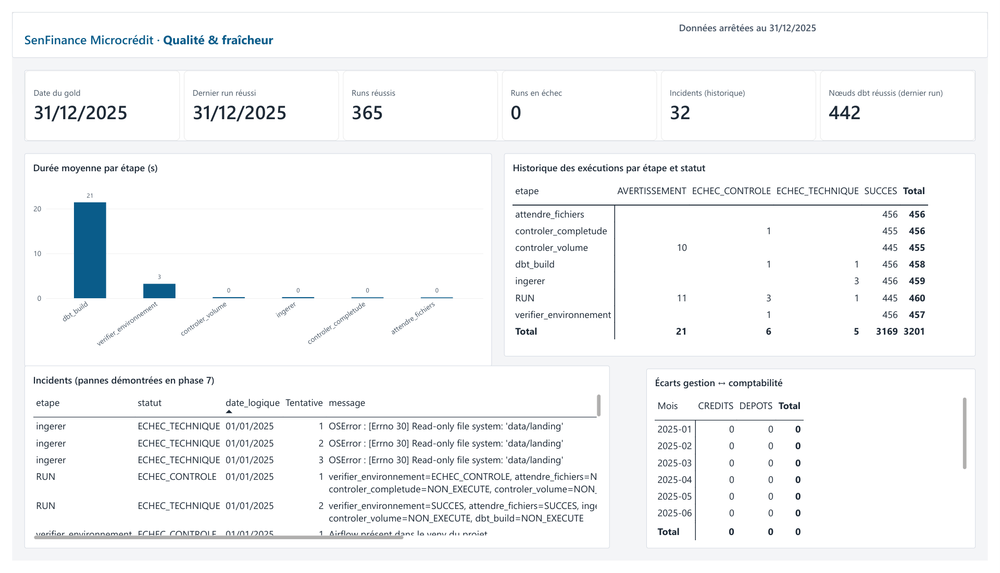
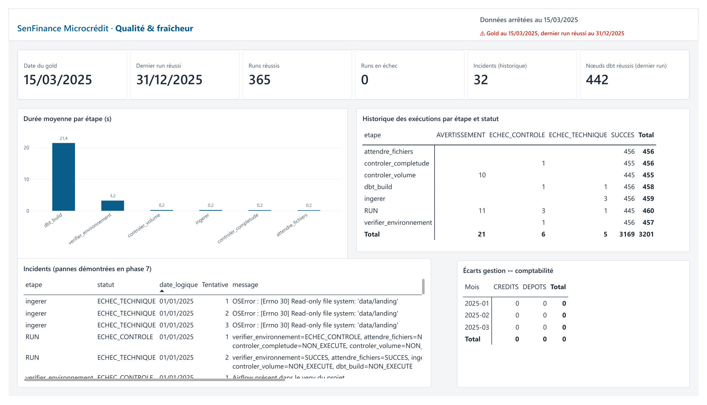

# SenFinance Microcrédit – pipeline de données & états financiers

[](https://github.com/NdeyePendaSarr/imf-data-pipeline/actions/workflows/ci.yml)
[](https://github.com/NdeyePendaSarr/imf-data-pipeline/actions/workflows/bigquery.yml)
[](https://ndeyependasarr.github.io/imf-data-pipeline/)

> **EN —** End-to-end ELT pipeline for a fictional Senegalese microfinance institution: synthetic
> operations → PostgreSQL → dbt (bronze / silver / gold) → star schema, double-entry bookkeeping,
> monthly trial balances, financial statements and loan-portfolio KPIs (PAR 30), orchestrated by
> Airflow and shown in a Power BI dashboard. The same dbt project also runs on BigQuery, with an
> automated engine-to-engine comparison (0 difference).

Les neuf phases du plan sont terminées : données générées, ingestion, dbt sur PostgreSQL et
BigQuery, orchestration Airflow, dashboard Power BI, intégration continue. Documentation dbt
(lignage, modèles, tests) : **[ndeyependasarr.github.io/imf-data-pipeline](https://ndeyependasarr.github.io/imf-data-pipeline/)**.

## Objectif

SenFinance Microcrédit est une institution de microfinance (IMF) **fictive**, présente dans plusieurs
régions du Sénégal. Ce projet transforme ses opérations brutes (dépôts, retraits, crédits,
remboursements, charges) en :

- **indicateurs de pilotage du portefeuille** : encours, PAR 30, taux de remboursement ;
- **comptabilité** : écritures, balances mensuelles, compte de résultat et bilan simplifié
  (logique SYSCOHADA, plan de comptes simplifié) ;
- **contrôles** : rapprochements gestion ↔ comptabilité et tests de qualité automatisés.

## Avancement

| Phase | Contenu | État |
|---|---|:---:|
| 0 | Cadrage : plan de comptes, schéma en étoile, règles de mapping | ✅ |
| 1 | Socle : Docker, PostgreSQL, environnement Python | ✅ |
| 2 | Générateur de données fictives et anomalies injectées | ✅ |
| 3 | Ingestion incrémentale et idempotente (bronze) | ✅ |
| 4 | Nettoyage et standardisation avec dbt (silver) | ✅ |
| 5 | Schéma en étoile et écritures comptables (gold) | ✅ |
| 6 | Balances, états financiers, KPI, rapprochements | ✅ |
| 7 | Orchestration Airflow | ✅ |
| 8 | Dashboard Power BI | ✅ |
| 9 | CI, documentation, entrepôt cloud (BigQuery) | ✅ |

Chiffres de la phase 9, sur des runs réels :

| Contrôle | Résultat |
|---|---|
| CI PostgreSQL (chaque push et pull request vers `main`) | [run 45395881197](https://github.com/NdeyePendaSarr/imf-data-pipeline/actions/runs/45395881197) : **75 s**, `dbt build` 457 PASS, 227 tests pytest |
| Job BigQuery (manuel, fédération d'identité) | [run 45396166776](https://github.com/NdeyePendaSarr/imf-data-pipeline/actions/runs/45396166776) : **351 s**, 457 PASS sur BigQuery, comparaison **71 mesures, 0 écart** |
| `make rebuild-bq` sur le poste | ≈ 4 min 30 : chargement du bronze, `dbt build --target bq`, comparaison, 0 écart |
| Tests | 457 nœuds dbt (388 tests de données, 10 unitaires, 7 tests de macros, 6 seeds, 46 modèles) ; 227 tests pytest |
| Contrôle de volume (correctif K11) | pas de contrôle sous 20 opérations de référence ; rejoué sur 2025 : 323 jours contrôlés, 0 avertissement, ratios de 71 % à 148 % |

## Architecture



Le même projet dbt tourne sur deux cibles : `dev` (PostgreSQL, référence) et `bq` (BigQuery).
`dbt build --target bq` reconstruit silver et gold dans BigQuery à partir du bronze chargé ; la
comparaison vérifie ensuite que les deux moteurs donnent les mêmes chiffres.

## Stack

| | Outils |
|---|---|
| **En place** | Python 3.12 (uv, ruff, mypy, pytest) · PostgreSQL 17 · Docker Compose · dbt Core 1.12 (dbt-postgres, dbt-bigquery, dbt_utils) · Apache Airflow 3.3 · Power BI Desktop · Google BigQuery (bac à sable) · GitHub Actions · GitHub Pages |

## Lancer le projet

**Prérequis :** Docker, [uv](https://docs.astral.sh/uv/), make.
Sous Windows : WSL2 + Docker Desktop, dépôt cloné dans WSL2.

```bash
git clone https://github.com/NdeyePendaSarr/imf-data-pipeline.git
cd imf-data-pipeline
cp .env.example .env   # puis choisis un mot de passe dans .env
make install           # environnement Python
make up                # démarre PostgreSQL
make test              # tests rapides
make generate          # génère data/ et remplit imf_ops
make ingest-all        # ingère tout l'exercice dans bronze (imf_dwh)
make dbt-build         # silver et gold : seeds, modèles et tests dbt
```

BigQuery (phase 9, facultatif : projet Google Cloud, `gcloud auth application-default login`,
`BQ_PROJECT` et `BQ_LOCATION` dans `.env`) :

```bash
make load-bq           # copie le bronze et audit_runs vers BigQuery (Parquet, load jobs)
make rebuild-bq        # load-bq, dbt build --target bq, puis compare-moteurs
make compare-moteurs   # compare gold et silver PostgreSQL / BigQuery ; échoue au moindre écart
```

**Se connecter :**

| Base | Rôle |
|---|---|
| `imf_ops` | base opérationnelle simulée (source) |
| `imf_dwh` | entrepôt : schémas `bronze`, `silver`, `gold` |

- Terminal : `make psql-dwh` ou `make psql-ops`
- Client graphique (DBeaver, pgAdmin) : hôte `localhost`, port `5433`, identifiants du `.env`

`make help` liste toutes les commandes.

## Générer les données

```bash
make generate          # configuration par défaut : 2 000 clients, 3 000 crédits, seed 42
make generate-small    # petit jeu : 100 clients, 150 crédits
uv run python -m generator --exercice 2025 --clients 2000 --credits 3000 --seed 42 \
    --taux-anomalies 0.01 --sortie data [--sans-db]
```

Le générateur réécrit `data/` entièrement et recharge `imf_ops` dans une seule transaction
(`--sans-db` : fichiers seulement). Même seed → mêmes fichiers, octet pour octet.

**Principe : vérité propre + anomalies.** Le générateur simule d'abord une **vérité propre**
cohérente (soldes jamais négatifs, échéanciers exacts, TEG ≤ 24 %, PAR 30 calibré, caisses et
banque toujours positives), écrite dans `data/_verite/` pour les tests, jamais ingérée. Il
injecte ensuite, avec un flux aléatoire séparé, des **anomalies** dans les sorties brutes, chacune
listée dans `data/catalogue_anomalies.csv` avec son traitement attendu. Appliquer ces traitements
aux sorties brutes redonne exactement la vérité : c'est le contrat du futur nettoyage (silver).

Les décaissements suivent une courbe mensuelle de croissance régulière (config.py), avec la
saisonnalité des produits (AGRICOLE de mai à juillet, SCOLAIRE d'août à octobre) et sans
rattrapage de fin d'année : un crédit qui ne trouve pas de client éligible dans son mois est
abandonné. Aucun crédit en janvier : les premières adhésions datent du 01/01 et un crédit exige
30 jours d'ancienneté du compte.

| Sortie | Contenu |
|---|---|
| `imf_ops` (PostgreSQL) | clients, comptes, produits_credit, credits, echeancier, remboursements |
| `data/<table>/date=AAAA-MM-JJ/` | operations (dépôts, retraits, frais de tenue), charges, appro_caisse : un fichier par jour avec des lignes |
| `data/*.csv` | instantanés : agences, ouverture (capital, fonds de caisse), catalogue_anomalies |
| `data/_verite/`, `data/_manifest.json` | vérité propre ; paramètres, volumes, indicateurs, SHA-256 |

**Volumes et indicateurs de l'exécution par défaut** (relevés dans `data/_manifest.json`) :

| Table | Vérité | Brut |
|---|---:|---:|
| clients | 2 000 | 2 000 |
| comptes | 2 317 | 2 317 |
| credits | 3 000 | 3 000 |
| echeancier | 34 037 | 34 037 |
| remboursements | 11 684 | 11 918 |
| operations (365 fichiers journaliers) | 66 514 | 68 848 |
| charges (83 fichiers journaliers) | 227 | 229 |
| appro_caisse (104 fichiers journaliers) | 141 | 141 |
| catalogue_anomalies | — | 2 916 |

| Indicateur au 31/12/2025 | Valeur |
|---|---:|
| PAR 30 (encours en retard > 30 j / encours) | 5,00 % |
| Encours total des crédits en cours | 1 850 520 623 XOF |
| Encours en retard de plus de 30 jours | 92 511 316 XOF |
| Capital d'ouverture | 1 797 000 000 XOF |
| Approvisionnements de caisse | 141 |
| Caisse minimale (agence, fin de journée) | 3 002 580 XOF |
| Banque minimale (fin de journée) | 163 883 235 XOF |

| Anomalie | Table | Lignes | Traitement attendu |
|---|---|---:|---|
| DOUBLON_EXACT | operations | 665 (1 004 copies) | DEDOUBLONNER |
| ORPHELIN_COMPTE | operations | 665 | REJETER |
| MONTANT_NEGATIF | operations | 665 | REJETER |
| FORMAT_CANAL | operations | 665 | STANDARDISER |
| CANAL_NON_AUTORISE | charges | 2 | REJETER |
| DATE_INCOHERENTE | remboursements | 117 | REJETER |
| MONTANT_PAYE_INCOHERENT | remboursements | 117 | REJETER |
| NULL_NON_CRITIQUE | clients | 20 | ACCEPTER_NULL |

## Ingestion bronze

```
imf_ops (PostgreSQL) ──COPY TO, fenêtre ]filigrane, J+1 00:00[──► data/landing/imf_ops/<table>/date=J/
data/<table>/date=J/ (CSV des agences) ─────────────────────────────┐            │
data/*.csv (instantanés) ───────────────────────────────────────────┤            │
                                                                    ▼            ▼
                                          même chargeur COPY ──► imf_dwh.bronze (+ _filigranes, _ingestions)
```

Chaque jour J est ingéré dans **une seule transaction** (données, filigranes et journal) : une
erreur annule tout le jour et la commande sort en erreur. Le rattrapage boucle jour par jour avec
le même code.

| Table bronze | Source | Mode |
|---|---|---|
| `csv_operations`, `csv_charges`, `csv_appro_caisse` | CSV des agences | partition du jour : ignorée si le même SHA-256 est déjà chargé, remplacée sinon ; aucun dédoublonnage |
| `csv_agences`, `csv_ouverture` | CSV des agences | instantané : rechargé en entier si son SHA-256 change |
| `meta_catalogue_anomalies` | métadonnée de test | instantané |
| `ops_produits_credit`, `ops_clients`, `ops_comptes`, `ops_credits`, `ops_echeancier`, `ops_remboursements` | imf_ops | filigrane sur `date_maj` ; une ligne par version, `UNIQUE (clé, date_maj)` |
| `_filigranes`, `_ingestions` | — | pilotage : filigrane par table, journal par run et par objet (CHARGE, IGNORE, VIDE) |

Chaque ligne porte `_id_run` (`AAAA-MM-JJ#n`), `_source`, `_num_ligne`, `_sha256` et
`_charge_le`. Le bronze est lié à une génération : une autre génération de `data/` est refusée
(`make reset-bronze`).

```bash
make ingest DATE=2025-03-15                # un jour
make ingest-range DU=2025-01-01 AU=2025-06-30
make ingest-all                            # tout l'exercice, jour par jour
make reset-bronze                          # vide le schéma bronze (imf_dwh uniquement)
```

**Rattrapage complet de l'exercice par défaut** (`make reset-bronze && make ingest-all`, mesuré
sur une vraie exécution) : 365 runs en **26,8 s**, 4 380 lignes de journal. Chaque table bronze
a exactement le volume brut du manifeste :

| Table bronze | Lignes |
|---|---:|
| `csv_operations` | 68 848 |
| `csv_charges` | 229 |
| `csv_appro_caisse` | 141 |
| `csv_agences` | 6 |
| `csv_ouverture` | 6 |
| `meta_catalogue_anomalies` | 2 916 |
| `ops_produits_credit` | 4 |
| `ops_clients` | 2 000 |
| `ops_comptes` | 2 317 |
| `ops_credits` | 3 000 |
| `ops_echeancier` | 34 037 |
| `ops_remboursements` | 11 918 |

## Silver (dbt)

```
bronze ──► stg_<table> (vues) ──► slv_<table> (tables, contrat dbt) ──► int_mouvements_compte
                │
                └──────────────► slv_lignes_ecartees (motif + traitement + _source, _num_ligne)
```

- **stg_** : typage sûr des colonnes TEXT (`vers_bigint`, `vers_date` : sinon NULL et motif
  TYPE_INVALIDE), codes standardisés `upper(trim())`, dernière version par clé pour imf_ops,
  rang de doublon par identifiant pour les CSV, et **un seul** `motif_ecart` par ligne
  (TYPE_INVALIDE > ORPHELIN_COMPTE > MONTANT_NEGATIF > CANAL_NON_AUTORISE > DATE_INCOHERENTE >
  MONTANT_PAYE_INCOHERENT ; copie d'un doublon → DOUBLON_EXACT).
- **slv_** : les lignes sans motif, avec les noms de colonnes de la source, `_id_run` et `_source`
  (`credits.statut` devient `statut_au_31_12`). Aucun modèle incrémental.
- **slv_lignes_ecartees** : tout ce qui n'est pas en silver, avec sa traçabilité bronze. Rien
  n'est filtré en silence.
- **int_mouvements_compte** : un mouvement par ligne sur un compte client (DEPOT, RETRAIT,
  FRAIS_TENUE, DECAISSEMENT, FRAIS_DOSSIER, PRELEVEMENT), `montant_signe` > 0 s'il augmente le solde.

```bash
make dbt-deps      # installe dbt_utils
make dbt-build     # seeds + modèles + tests (prérequis : make ingest-all)
make test-verite   # chaque slv_* = data/_verite/<table>.csv (la vérité n'entre jamais en base)
```

À la fin de la phase 4, `dbt build` sur l'exercice par défaut donnait **153 PASS, 0 WARN,
0 ERROR** (5 seeds, 25 modèles, 122 tests de données dont `canal_autorise`, 1 test unitaire de
`int_mouvements_compte`) ; état actuel du projet : section Marts. Les tests de catalogue comparent les lignes écartées aux anomalies injectées :

| Nature (catalogue) | Table | Lignes du catalogue | Lignes attendues | Lignes écartées |
|---|---|---:|---:|---:|
| DOUBLON_EXACT | operations | 665 | 1 004 (copies) | 1 004 |
| ORPHELIN_COMPTE | operations | 665 | 665 | 665 |
| MONTANT_NEGATIF | operations | 665 | 665 | 665 |
| CANAL_NON_AUTORISE | charges | 2 | 2 | 2 |
| DATE_INCOHERENTE | remboursements | 117 | 117 | 117 |
| MONTANT_PAYE_INCOHERENT | remboursements | 117 | 117 | 117 |
| FORMAT_CANAL (STANDARDISER) | operations | 665 | 0 (corrigées, gardées) | 0 |
| NULL_NON_CRITIQUE (ACCEPTER_NULL) | clients | 20 | 0 (gardées) | 0 |
| **Total** | | | **2 570** | **2 570** |

Silver obtenu (= vérité, ligne pour ligne) : 66 514 opérations, 227 charges, 141
approvisionnements, 6 agences, 6 ouvertures, 4 produits, 2 000 clients, 2 317 comptes, 3 000
crédits, 34 037 échéances, 11 684 remboursements ; 74 515 mouvements de comptes.

## Gold (dbt) : schéma en étoile et écritures comptables

- **Dimensions** (clés naturelles) : `dim_date` (exercice et 2 années d'échéances, 1 095 jours),
  `dim_agence` (6, siège compris), `dim_client` (2 000, tranche d'âge au 31/12),
  `dim_compte_client` (2 317), `dim_produit_credit` (4), `dim_credit` (3 000),
  `dim_compte_comptable` (21, plan simplifié), `dim_journal` (7).
- **Écritures** (`fct_ecritures`) : chaque événement de gestion devient une pièce en partie double
  par jointure avec les règles du mapping comptable (seeds, version v0.4), le compte de trésorerie
  résolu par le canal et le journal choisi par priorité. Aucune règle n'est écrite en dur dans le
  SQL : changer une écriture, c'est changer un seed.
- **Faits de gestion** : `fct_operations`, `fct_remboursements`, `fct_echeances` (couverture
  FIFO au 31/12), `fct_portefeuille_quotidien` (un crédit × un jour ouvré : encours, jours et
  tranche de retard), `fct_solde_compte_mensuel` (12 fins de mois).

Résultats sur l'exercice par défaut :

| Contrôle | Résultat |
|---|---|
| Pièces / lignes d'écriture | 84 572 pièces, 181 193 lignes (= tous les événements, 0 rejet) |
| Équilibre débit = crédit | 13 140 567 531 XOF au débit et au crédit, chaque pièce équilibrée |
| Caisse minimale (agence, fin de journée) | 3 002 580 XOF, égale à celle du générateur |
| Banque minimale (fin de journée) | 163 883 235 XOF, égale à celle du générateur |
| PAR 30 au 31/12 | 92 511 316 / 1 850 520 623 XOF, égal à la vérité au franc près (pytest) |
| Lignes des faits | portefeuille quotidien 404 573 (jours calendaires depuis la phase 6, H1), échéances 34 037, opérations 66 514, remboursements 11 684, soldes mensuels 14 946 |
| `dbt build` (fin de la phase 5) | 352 PASS, 0 WARN, 0 ERROR (303 tests de données, 3 tests unitaires) |

## Marts (dbt) : états financiers, rapprochements et KPI

- `mart_balance` : balance mensuelle à 6 colonnes (ouverture, mouvements, clôture, au débit et au
  crédit) par compte × agence ; ouverture de janvier à 0 ; un compte reste présent dès son premier
  mouvement.
- `mart_compte_resultat` : rubrique × mois, montant du mois et cumul ; résultat = produits − charges.
- `mart_bilan` : rubriques × fin de mois au niveau de l'IMF, soldes calculés sur les mouvements de
  toutes les agences ; un solde inversé (liaison agents ou mobile money créditrice) est reclassé en
  dette (règle portée par le plan de comptes) ; le résultat cumulé est au passif.
- `mart_rapprochements` : fin de mois × agence × contrôle, gestion ↔ comptabilité (dépôts des
  clients ↔ `DEPOTS_EPARGNE`, encours ↔ `CREDITS_SAINS`), avec l'écart.
- `mart_kpi_portefeuille` : jour × agence × produit ; numérateurs et dénominateurs seulement (encours,
  encours à plus de 30 jours, dû échu, payé imputé), les ratios sont recalculés à l'affichage.

Résultats sur l'exercice par défaut :

| Contrôle | Résultat |
|---|---|
| Bilan au 31/12/2025 | actif = passif + résultat = 2 119 584 054 XOF, chaque fin de mois |
| Résultat de l'exercice | −333 130 376 XOF (164 015 389 de produits, 497 145 765 de charges), égal à la vérité |
| PAR 30 au 31/12 | 92 511 316 / 1 850 520 623 XOF = 4,9992 %, égal à la vérité au franc près |
| Taux de remboursement au 31/12 | 999 172 879 / 1 039 096 786 XOF = 96,16 % (paiements anticipés non comptés) |
| Rapprochements | 120 lignes (12 mois × 5 agences × 2 contrôles), écart 0 partout |
| Lignes des marts | balance 879, compte de résultat 48, bilan 72, rapprochements 120, KPI 5 283 |
| `make check` (état actuel, phase 8) | `dbt build` : 450 PASS, 0 WARN, 0 ERROR (388 tests de données, 10 tests unitaires dont les cas chiffrés calculés à la main de `docs/cadrage/P1_cas_chiffres_tests.md`, 6 seeds, 46 modèles) ; 203 tests pytest |

## Arrêté intermédiaire

Le gold et les marts se calculent à une date d'arrêté (variable dbt `date_arrete`, par défaut le
31/12 de l'exercice) :

```bash
make ingest-range DU=2025-01-01 AU=2025-03-31
uv run --env-file .env dbt build --project-dir dbt --profiles-dir dbt --vars '{date_arrete: "2025-03-15"}'
```

- **Aucune date postérieure à l'arrêté** dans le gold (test `gold_aucune_date_apres_arrete`), sauf,
  par nature, le calendrier `dim_date` et les dates prévues des échéances futures
  (`fct_echeances.date_prevue`). Un test bloquant vérifie que le bronze est ingéré au moins
  jusqu'à l'arrêté.
- **Mois partiel** : les marts mensuels vont jusqu'au mois de l'arrêté inclus ; la colonne
  `date_situation` = la fin de mois, ou la date d'arrêté pour le mois en cours (au 15/03 : mars
  à la date du 15/03). Vérifié aux arrêtés du 15/01, du 15/03 et du 31/03 : bilan équilibré,
  rapprochements à 0.
- **Tests ramenés à l'arrêté** (aucun n'a eu besoin d'un tag de fin d'exercice) :
  `catalogue_1_ecartees_attendues`, `catalogue_3_standardiser`, `catalogue_4_accepter_null`
  (anomalies dont la ligne est datée au plus tard à l'arrêté, colonne `date_ligne` du
  catalogue) ; `portefeuille_fins_de_mois`, `portefeuille_31_08_et_30_11` ;
  `balance_cloture_a_l_arrete`, `compte_resultat_cumul_a_l_arrete` (dernier mois présent =
  écritures jusqu'à l'arrêté) ; `rapprochements_grille_complete` ;
  `kpi_a_l_arrete_egal_portefeuille` (avec une garde contre une comparaison vide) ;
  `ecritures_dans_exercice`, `ecritures_completude`, `ecritures_montants_par_type`. Les tests
  unitaires fixent leur propre arrêté : ils testent une logique, pas une date.
- **Statut à l'arrêté** : `dim_credit.statut_a_l_arrete` (EN_COURS ou SOLDE selon le capital
  remboursé jusqu'à l'arrêté) ; égal à `statut_au_31_12` à l'arrêté par défaut (test). Au 31/03,
  75 crédits sont EN_COURS alors que `statut_au_31_12` les dit déjà SOLDE.
- **Limite (I10)** : la base opérationnelle simulée ne garde que l'état au 31/12 ;
  `statut_au_31_12` est connu dès le décaissement et ne sert à aucun calcul. Les tests pytest de
  vérité ne valent qu'à l'arrêté par défaut (la vérité porte sur l'exercice complet).

## Orchestration (phase 7)

Airflow 3.3.2 (Python 3.12) tourne dans Docker, profil `airflow` du `docker-compose.yml` : base
de métadonnées `airflow-db` (PostgreSQL 17), `airflow-init` (migration et compte administrateur),
`airflow-api-server`, `airflow-scheduler`, `airflow-dag-processor`, en LocalExecutor
(parallélisme 2). L'image contient deux environnements séparés : celui d'Airflow, sans dbt, et le
venv du projet `/opt/pipeline-venv` (construit par `uv sync --frozen` depuis `uv.lock`, groupe dbt
compris), sans Airflow. Le dépôt est monté en lecture seule ; seul `data/` est en écriture, et dbt
écrit ses artefacts hors du dépôt.

```bash
# Une fois : renseigner dans .env les variables AIRFLOW_* listées dans .env.example
make airflow-up      # construit l'image et démarre les services (attend qu'ils soient healthy)
make test-airflow    # intégrité des DAG, dans le conteneur
make airflow-logs    # journaux
make airflow-down    # arrêt (la base de métadonnées est conservée)
```

Interface : http://localhost:8080 (compte `AIRFLOW_ADMIN_USER` du `.env`). Le composant
**Triggerer** y apparaît en rouge : c'est voulu, aucun triggerer n'est déployé, car le DAG
n'utilise aucune tâche différée (le capteur tourne en mode reschedule, sans triggerer).

### DAG `imf_quotidien`

Un run par jour de l'exercice (`@daily`, du 01/01 au 31/12 de `IMF_EXERCICE`, sans catchup,
un seul run actif, `depends_on_past`, 2 retries à délai exponentiel à partir de 2 min) :

```
verifier_environnement → attendre_fichiers → ingerer → controler_completude
  → controler_volume → dbt_build → ecrire_audit (teardown)
```

Chaque tâche lance une commande du paquet `orchestration/` dans le venv du projet (Airflow n'y
est jamais importé) : `python -m orchestration <commande> --date AAAA-MM-JJ`. La dernière ligne
de sa sortie est un résumé JSON ; le code de sortie fixe la suite :

| Code | Statut | Effet dans Airflow |
|---|---|---|
| 0 | `SUCCES` ou `AVERTISSEMENT` | tâche verte |
| 3 | `ECHEC_CONTROLE` (donnée ou test faux) | échec immédiat, **sans retry** |
| autre | `ECHEC_TECHNIQUE` (base injoignable, dbt code 2…) | retry |

| Commande | Contrôle |
|---|---|
| `attendre` | capteur (mode reschedule, 60 s, 1 h) : fichiers du jour déclarés par le manifeste |
| `completude` | lignes en bronze = `lignes_fichiers` du manifeste (CSV) et = lignes de landing (imf_ops) |
| `volume` | opérations du jour / référence corrigée de la tendance (ci-dessous), hors de [50 % ; 200 %] → avertissement, jamais bloquant |
| `dbt` | `dbt build --vars '{date_arrete: J}'`, puis lecture de `run_results.json` : nœud en error, fail ou skipped → code 3 |

**Contrôle de volume.** Le volume du jour est comparé à ce qu'il était les jours comparables,
corrigé de la croissance récente du portefeuille. Paramètres :
- jour ordinaire : moyenne des 4 mêmes jours de semaine précédents (derniers jours ouvrés du
  mois exclus), × facteur de tendance = opérations par jour ordinaire des 7 derniers jours /
  moyenne de la même mesure décalée de 1 à 4 semaines ;
- dernier jour ouvré du mois (lundi à samedi) : la fin de mois précédente, × facteur de
  tendance sur 28 jours ordinaires (les 28 derniers / les 28 avant la fin de mois précédente) ;
- plage acceptée [50 % ; 200 %] de la référence ; dimanche à 0 normal ; pas de contrôle sans
  4 semaines d'historique ingéré ni, pour une fin de mois, sans fin de mois précédente dans
  l'exercice.

Rejouée sur 2025, la règle ne lève aucune alerte (ratios de 63 % à 198 %, extrêmes sur des
dimanches à 9-20 opérations) ; un mardi de juin ou la fin septembre divisés par 3 tombent à
34 % et alertent. L'ancienne règle (4 mêmes jours de semaine, sans tendance) levait 10 alertes
sur le trimestre, toutes structurelles : croissance du portefeuille (≈ 190 comptes ouverts par
mois, 27 opérations par jour en janvier, 387 en décembre) et vendredis de fin de mois dans la
moyenne de référence. **Limite :** la règle détecte une rupture brutale, pas une dérive lente,
puisque le facteur de tendance s'adapte en une semaine ; sur un dimanche, petit effectif, la
marge vers 200 % est faible.

Chaque tentative de chaque étape écrit une ligne dans `audit.audit_runs` (append-only, source
dbt `audit`) : statut, durée, lignes chargées, compteurs dbt, nœuds en échec et sautés, version
du mapping, commit git. Le teardown `ecrire_audit` ajoute la ligne `etape = 'RUN'`, au statut
global (`NON_EXECUTE` pour une étape sans résumé). Si la base est injoignable, la ligne attend
dans `data/_audit_en_attente.jsonl` et est versée à l'écriture suivante.

### Reprendre un jour en échec

Avec `depends_on_past` et un seul run actif, un jour en échec bloque la suite : le run du
lendemain démarre mais ses tâches attendent la veille, et occupe la seule place. Après avoir
corrigé la cause :

```bash
make airflow-reprendre JOUR=2025-02-12 ETAPE=ingerer    # fichier source corrigé
make airflow-reprendre JOUR=2025-02-12 ETAPE=dbt_build  # seed ou modèle corrigé
make airflow-reprendre JOUR=2025-02-12                  # toutes les étapes
```

La cible remet à zéro les tâches du jour à partir de l'étape (aval compris), vérifie qu'elles
l'ont bien été (sinon : erreur, rien d'autre n'est touché), puis repasse en file les runs
suivants déjà démarrés : le scheduler reprend dans l'ordre des dates. Inutile pour une panne
transitoire, que les retries absorbent.

**Empreinte du gold.** `make empreinte-gold FICHIER=…` écrit le MD5 du contenu trié (toutes
colonnes) de chacune des 19 tables gold ; une table légitimement vide est notée `VIDE` (à
l'arrêté du 15/01 : `dim_credit`, les faits crédit et `mart_kpi_portefeuille`, aucun crédit
n'étant encore décaissé). Elle échoue si le schéma n'a pas 19 tables ou si une empreinte est
cassée (absente, mal formée, ou incohérente avec le nombre de lignes). `make compare-empreintes A=… B=…` échoue si deux empreintes diffèrent.

**Fichier source corrigé.** L'ingestion ne se fie pas au nom du fichier mais à son SHA-256 :
même empreinte que la dernière chargée → `IGNORE` ; empreinte différente → la partition
(`_source`) est supprimée puis rechargée en entier, dans la même transaction. Procédure :
1. remplacer le CSV par la version corrigée, au même chemin (son empreinte doit être celle du
   manifeste, sinon `completude` échouera de nouveau) ;
2. `make airflow-reprendre JOUR=… ETAPE=ingerer` ;
3. vérifier que la partition ne contient qu'un run et le nombre de lignes du manifeste (requête
   de la panne a ci-dessous).

### Démonstration : backfill du 01/01 au 31/03 et trois pannes

```bash
make reset-bronze
docker compose --profile airflow exec airflow-scheduler airflow backfill create \
  --dag-id imf_quotidien --from-date 2025-01-01 --to-date 2025-03-31 \
  --max-active-runs 1 --reprocess-behavior failed
```

(`--reprocess-behavior` est obligatoire dès qu'une tâche a `depends_on_past`.) Les 90 runs
finissent verts. Le gold au 31/03 issu du backfill est identique, sur les 19 tables (MD5 du
contenu trié), à un `dbt build --vars '{date_arrete: 2025-03-31}'` lancé à la main : bilan
**1 866 378 469 XOF** (actif = passif), résultat cumulé **−114 897 159 XOF**.

**a) Fichier incomplet** — une ligne retirée de `operations/date=2025-02-12/operations.csv`
avant son ingestion : `controler_completude` passe au rouge (44 lignes en bronze, 45 au
manifeste), sans retry ; le 13/02 ne dépasse pas `attendre_fichiers`. Fichier restauré, puis
`make airflow-reprendre JOUR=2025-02-12 ETAPE=ingerer` : la partition est rechargée par
empreinte (run `#2`, 45 lignes).

```sql
SELECT etape, tentative, statut, message FROM audit.audit_runs
WHERE date_logique = '2025-02-12' ORDER BY id_audit;

SELECT count(*) AS lignes, count(DISTINCT id_operation) AS ids, string_agg(DISTINCT _id_run, ',') AS runs
FROM bronze.csv_operations WHERE _source = 'operations/date=2025-02-12/operations.csv';
-- 45 | 45 | 2025-02-12#2   (manifeste : 45)
```

**b) Mapping incomplet** — la ligne `MOBILE` retirée de `mapping_canal_tresorerie.csv` : les
opérations mobile money tombent dans `int_evenements_rejetes`, le test
`evenements_rejetes_vide` échoue, `dbt_build` passe au rouge sans retry (346 PASS, 1 ERROR,
95 nœuds sautés, listés dans l'audit). Seed restauré, puis
`make airflow-reprendre JOUR=2025-02-12 ETAPE=dbt_build` : 442 PASS, le backfill continue.

```sql
SELECT tentative, statut, nb_pass, nb_error, nb_skip, noeuds_en_echec, noeuds_sautes
FROM audit.audit_runs WHERE date_logique = '2025-02-12' AND etape = 'dbt_build';
```

**c) Base arrêtée** — `docker compose stop postgres` pendant `dbt_build` du 10/03, redémarrée
45 s plus tard : tentative 1 en `ECHEC_TECHNIQUE` (dbt code 2), sa ligne d'audit mise en attente
puis versée ; tentative 2 en `SUCCES` après le délai de retry.

```sql
SELECT tentative, statut, debut, fin, message FROM audit.audit_runs
WHERE date_logique = '2025-03-10' AND etape = 'dbt_build' ORDER BY id_audit;
```

L'ancienne règle de volume a levé dix avertissements sur le trimestre, tous structurels (voir
« Contrôle de volume ») ; la règle actuelle n'en aurait levé aucun :

```sql
SELECT date_logique, message FROM audit.audit_runs
WHERE etape = 'controler_volume' AND statut = 'AVERTISSEMENT' ORDER BY 1;
```

**Mesures du trimestre** (WSL2, 85 runs sans incident) : run moyen **45 s** (médiane 36 s, dont `dbt build`
~25 s en janvier-février et ~32 s en mars), 2 s entre deux runs. Backfill de 90 jours : 1 h 53
d'horloge, dont environ 70 min de calcul, le reste étant l'attente des corrections manuelles.
Pic mémoire du scheduler (`memory.peak` du cgroup) : **685 Mio**, 67 % de sa limite d'alors
(1 Gio, portée depuis à 1,5 Gio). L'estimation qui en découlait pour 365 jours (5 à 6 h) s'est
révélée pessimiste : voir ci-dessous.

### Backfill de l'exercice 2025

Le gold de référence est d'abord calculé en une fois, bronze complet et `dbt build` par défaut :
`make empreinte-gold FICHIER=docs/phase7/empreinte_gold_reference_31_12.txt`.

> **Référence de la phase 7, à ne pas régénérer.** L'égalité entre le gold du backfill et ce
> fichier valait au commit `c0f220f`. La phase 8 a ensuite ajouté `libelle_rubrique` (K14) à
> `mart_bilan` et `mart_compte_resultat` : les empreintes de ces deux tables changent (mêmes
> lignes, mêmes montants), les 17 autres sont identiques. La référence du gold actuel est
> `docs/phase8/empreinte_gold_reference_31_12.txt`.

Puis, depuis un état propre (`make reset-bronze`, runs du DAG supprimés par `airflow dags delete`
pour que chaque jour s'exécute réellement, tentatives à 1 ; l'audit, en ajout seul, est
conservé) :

```bash
docker compose --profile airflow exec airflow-scheduler airflow backfill create \
  --dag-id imf_quotidien --from-date 2025-01-01 --to-date 2025-12-31 \
  --max-active-runs 1 --reprocess-behavior completed
```

Résultat, sans aucune intervention :

| Contrôle | Résultat |
|---|---|
| Runs | 365 lignes `RUN` en `SUCCES`, chaque étape à la tentative 1 (2 555 lignes d'audit) |
| Gold au 31/12 | `make compare-empreintes` : identique à la référence sur les 19 tables, au commit `c0f220f` (voir la note ci-dessous) |
| Bilan au 31/12 | actif = passif = **2 119 584 054 XOF** |
| Résultat de l'exercice | **−333 130 376 XOF** |
| PAR 30 au 31/12 | 92 511 316 / 1 850 520 623 = **4,9992 %** |
| Rapprochements | 120 contrôles (12 mois), écart 0 partout |
| Contrôle de volume | 331 jours contrôlés, **0 avertissement** (ratios de 63 % à 198 %) ; 34 jours sans contrôle (du 01/01 au 03/02 : la tendance remonte à J−35, et le 31/01 n'a pas de fin de mois précédente) |
| Durée totale | **3 h 27** (16:15:46 → 19:42:56), 2 s entre deux runs |
| Run moyen | 32 s (médiane 29 s) |
| Pic mémoire du scheduler | **716 Mio** (`memory.peak`), 47 % de 1,5 Gio, aucun redémarrage |

Durée moyenne d'un run par mois (dont `dbt build`) :

| Mois | 01 | 02 | 03 | 04 | 05 | 06 | 07 | 08 | 09 | 10 | 11 | 12 |
|---|---|---|---|---|---|---|---|---|---|---|---|---|
| Run (s) | 51,5 | 49,5 | 26,8 | 26,3 | 26,9 | 27,1 | 27,9 | 28,2 | 29,2 | 29,8 | 30,8 | 32,8 |
| dbt (s) | 34,7 | 27,0 | 17,8 | 17,4 | 17,9 | 18,3 | 18,7 | 19,3 | 20,1 | 20,8 | 21,7 | 23,8 |

À partir de mars, `dbt build` s'allonge régulièrement avec l'historique (≈ +0,6 s par mois).
Janvier et février sont plus lents alors que les données y sont moindres (jusqu'à 277 s pour
`dbt debug` dans `verifier_environnement` le 05/02, run le plus long, 325 s) : la première heure
du backfill (16:15 → ~17:05) a tourné avec l'économiseur d'énergie de Windows actif, désactivé
ensuite. C'est l'explication probable ; l'audit ne permet pas de la prouver.

```sql
-- Statuts des runs du backfill (filtre sur son heure de début)
SELECT statut, count(*) FROM audit.audit_runs
WHERE debut >= '2026-11-22 16:15:32+00' AND etape = 'RUN' GROUP BY 1;
```

Mémoire mesurée (`docker stats`) : **778 Mio au repos** pour les 4 services Airflow juste après le
démarrage (1 066 Mio avec le PostgreSQL du projet), 928 Mio après un `dbt build`. Pic du
scheduler, où tournent les tâches : 455 Mio pendant `verifier_environnement`, **545 Mio** pendant
un `dbt build` complet (pic mesuré par le cgroup), soit 53 % de sa limite d'alors (1 Gio).

## Dashboard Power BI (phase 8)

Trois pages en mode Import sur le gold et `audit.audit_runs` (`dashboard/senfinance_dashboard.pbix`) :
pilotage du portefeuille, états financiers, qualité et fraîcheur. Power BI se connecte au
conteneur (`localhost:5433`, base `imf_dwh`) avec le rôle en lecture seule `powerbi_lecteur`
(`make powerbi-role`) ; connexion, tables, grains et colonnes : [`dashboard/modele_donnees.md`](dashboard/modele_donnees.md).
Toutes les mesures DAX, avec leur formule et leur type : [`dashboard/mesures.md`](dashboard/mesures.md).

**Deux dates (K1).** Le bandeau « Données arrêtées au » affiche la date réelle du gold
(`date_situation` de `mart_bilan`), pas celle du dernier run : un `dbt build` lancé à la main
n'écrit rien dans l'audit. Si cette date diffère du dernier run réussi de l'audit, ou si le
dernier run a échoué, une alerte rouge s'affiche en tête de page.

**Mesures semi-additives (K2).** Les stocks (encours, PAR 30, taux de remboursement, épargne,
bilan) sont évalués au dernier jour qui a des données dans la période, le même pour toutes les
agences et plafonné à la date du gold, jamais sommés dans le temps : un `SUM` de l'encours sur un
mois le multiplierait par une trentaine. Les flux (opérations, résultat du mois) se somment ; les
ratios sont recalculés par `DIVIDE` à chaque niveau.

Au 31/12/2025, les chiffres de référence sont retrouvés : encours brut 1 850 520 623 XOF,
PAR 30 4,9992 %, bilan 2 119 584 054 XOF, résultat −333 130 376 XOF, contrôles à 0.







Test « à date » : gold reconstruit au 15/03/2025 par `dbt build --vars '{date_arrete: "2025-03-15"}'`,
sans Airflow (l'audit reste inchangé). Le bandeau passe au 15/03 et l'alerte K1 signale l'écart
avec le dernier run réussi, au 31/12 :



Les autres captures au 15/03 sont dans [`dashboard/captures/`](dashboard/captures/). Retour au
31/12 par un `dbt build` sans variable : gold identique à
`docs/phase8/empreinte_gold_reference_31_12.txt` (19 tables).

## BigQuery et intégration continue (phase 9)

### Intégration continue

| Workflow | Déclencheur | Contenu |
|---|---|---|
| [`ci.yml`](.github/workflows/ci.yml) | chaque push et pull request vers `main` | PostgreSQL 17 éphémère, ruff, mypy, `make generate`, `make ingest-all`, `make dbt-build` (457 PASS), pytest (227 tests ; les 14 tests Airflow tournent dans leur conteneur, `make test-airflow`) ; sur `main`, publication de la documentation dbt sur GitHub Pages |
| [`bigquery.yml`](.github/workflows/bigquery.yml) | manuel (`workflow_dispatch`), un seul run à la fois | même reconstruction PostgreSQL, puis `make rebuild-bq SANS_AUDIT=1` ; tableau de comparaison sur la page du run |

BigQuery n'est jamais sollicité à chaque push : le job est lancé à la main
(`gh workflow run bigquery.yml --ref main`).

### Le même projet dbt sur BigQuery

L'entrepôt est reconstruit dans un **bac à sable BigQuery**, sans compte de facturation, région
`EU` (datasets `bronze`, `audit`, `silver`, `gold`). Projet et région viennent de l'environnement
(`BQ_PROJECT`, `BQ_LOCATION`) : aucun identifiant n'est écrit dans le dépôt.

```bash
make rebuild-bq        # load-bq, dbt build --target bq, compare-moteurs (≈ 4 min 30)
```

- **Pas de Cloud Storage (écart au plan initial).** Sans compte de facturation, Cloud Storage
  n'est pas disponible. Le bronze est donc chargé directement depuis PostgreSQL : un fichier
  Parquet par table, chargé par un *load job* BigQuery (`WRITE_TRUNCATE`, aucune requête de
  modification, ce que le bac à sable n'autorise pas), avec un schéma explicite tiré d'une seule
  table de correspondance des types ; le nombre de lignes est vérifié après chaque chargement
  (`ingestion/charger_bq.py`).
- **Comparaison des moteurs.** `make compare-moteurs` (`scripts/comparer_moteurs.py`) compare
  PostgreSQL et BigQuery à la même date d'arrêté : encours, PAR 30 (numérateur et dénominateur),
  bilan et équilibre de chaque mois, résultat, rapprochements, lignes des 19 tables gold, lignes
  et sommes des montants des 15 tables silver. 71 mesures, **0 écart** ; le moindre écart fait
  échouer la commande et le job.
- **Authentification sans clé.** En local : identifiants par défaut de Google
  (`gcloud auth application-default login`). En CI : fédération d'identité (*Workload Identity
  Federation*) ; GitHub émet un jeton OIDC, échangé contre l'identité d'un compte de service.
  Aucune clé JSON, aucun secret : le fournisseur d'identité n'accepte que **ce dépôt** et la
  branche **`main`**.
- **L'audit n'est pas rechargé par la CI** (`SANS_AUDIT=1`). Le PostgreSQL éphémère de la CI n'a
  pas de journal Airflow : le chargeur y exclut `audit.audit_runs` et ne touche pas au dataset
  `audit`. Après un run CI, BigQuery contient : le bronze du dernier chargement (CI ou poste : mêmes
  données métier, seules les colonnes techniques d'ingestion diffèrent), silver et gold reconstruits,
  et l'audit chargé depuis le poste (3 201 lignes). Sans l'option, une table absente reste une
  erreur.
- **Expiration à 60 jours.** Dans le bac à sable, tables et vues expirent au bout de 60 jours :
  `make rebuild-bq` recrée tout l'entrepôt en une commande.
- **Quota, au pire cas.** L'entrepôt occupe ≈ 119 Mio logiques (bronze 26,5 ; silver 30,7 ;
  gold 61,0 ; audit 0,75). En supposant que le stockage des tables supprimées ne soit jamais
  rendu sur la limite de 10 Gio, cela laisse ≈ 85 reconstructions, soit ≈ 14 ans à une
  reconstruction tous les 60 jours. Garde-fou : une requête qui lirait plus de 1 Go échoue
  (`maximum_bytes_billed`).

### Portage PostgreSQL → BigQuery

Ordre de préférence : SQL standard commun aux deux moteurs, puis macros dbt (`dbt.date_trunc`,
`dbt.last_day`, `dbt.datediff`, `dbt.type_string`…), puis 8 macros maison `adapter.dispatch`
(`dbt/macros/`), chacune avec une version PostgreSQL, une version BigQuery et une version par
défaut qui échoue. Chaque macro maison est testée sur des valeurs littérales, sur les deux
moteurs (`dbt/tests/macros/`, par exemple : jour ISO du dimanche 16/02/2025 = 7, âge d'une
personne née un 29/02). Contrats dbt en types génériques (`string`, `integer`…) valables sur les
deux moteurs ; les taux restent `numeric(6,4)` sur PostgreSQL et passent en `NUMERIC` sur
BigQuery, qui refuse les types paramétrés dans un `CAST`. Côté PostgreSQL, un `analyze` après
chaque table construite garde des plans d'exécution corrects (`fct_ecritures` : plus de 9 min sans
statistiques, 2 s avec). Inventaire complet, cas par cas :
[`docs/phase9/inventaire_bq.md`](docs/phase9/inventaire_bq.md).

### Documentation dbt

Publiée sur GitHub Pages à chaque push sur `main` :
**[ndeyependasarr.github.io/imf-data-pipeline](https://ndeyependasarr.github.io/imf-data-pipeline/)**
(modèles, colonnes, tests et graphe de lignage, générés sur la base PostgreSQL de la CI).

## Structure actuelle

```
├── .github/workflows/      # ci.yml (PostgreSQL, tests, docs dbt) et bigquery.yml (manuel, sans clé)
├── airflow/                # image Airflow, DAG imf_quotidien, reprise et tests d'intégrité
├── orchestration/          # commandes du DAG (contrôles, dbt, audit), sans Airflow, et leurs tests
├── dashboard/              # Power BI : .pbix, captures, mesures DAX, modèle de données, thème, rôle de lecture
├── docker/postgres/init/   # création des bases et des schémas
├── dbt/                    # projet dbt : sources bronze, modèles et tests silver, seeds du cadrage
├── generator/              # générateur de données (vérité, anomalies, imf_ops) et ses tests
├── ingestion/              # ingestion bronze et chargeur BigQuery (charger_bq.py), et leurs tests
├── scripts/                # comparer_moteurs.py : comparaison PostgreSQL / BigQuery
├── docs/                   # cadrage public (PRD, phases), références d'empreinte, inventaire BigQuery
├── data/                   # sorties du générateur (non versionnées)
├── tests/                  # tests du socle, vérité silver et gold, comparaison des moteurs
├── docker-compose.yml
├── Makefile
└── pyproject.toml
```

## Limites

- Données **100 % fictives**.
- Plan de comptes **simplifié**, à codes internes : ce n'est pas le référentiel comptable officiel
  des SFD (RCSFD) ; les correspondances avec le SYSCOHADA sont **indicatives**.
- Liste complète des limites : [PRD, §12](docs/cadrage/PRD_pipeline_IMF_SYSCOHADA.md#12-limites-à-afficher-dans-le-readme).
- Approvisionnements des caisses en une seule pièce (journal VIR), sans compte de fonds en transit.
- Banque contrôlée au niveau de l'IMF (un seul compte bancaire), pas par agence.
- TEG calculé sur l'échéancier théorique, pas sur les paiements réels.
- Jours ouvrés du lundi au samedi, sans jours fériés.
- Pas de refinancement : le capital d'ouverture couvre seul le besoin de financement, d'où un
  capital élevé.
- Runs imf_ops cumulatifs (filigrane) : rejouer un jour passé ne recharge rien ; pour tout rejouer,
  make reset-bronze.
- La base opérationnelle simulée ne conserve que l'état au 31/12 : le statut des crédits n'est pas
  historisé.
- Pas de comptes de tiers par agent : les liaisons sont classées sur leur solde au niveau de l'IMF
  (écart chiffré sur la liaison agents : 13 297 824 XOF au 30/11/2025 entre P3 au niveau de l'IMF
  et la somme des soldes créditeurs par agence ; 9 590 935 XOF au 31/12/2025). Le mobile money n'a
  qu'un opérateur : son solde au niveau de l'IMF est le bon.
- Commissions mobile money de décembre facturées en janvier suivant : hors exercice (pas de charges
  à payer).
- Remboursements partiels : imputation pénalités → intérêts → capital par échéance ; 243 soldes
  d'échéance sans intérêts.
- BigQuery dans un bac à sable : pas de Cloud Storage (zone brute chargée depuis PostgreSQL),
  données supprimées au bout de 60 jours (`make rebuild-bq`), pas de requêtes de modification.
- L'audit BigQuery est la copie chargée depuis le poste : la CI ne le recharge pas.
- Airflow n'orchestre que la cible PostgreSQL ; BigQuery est reconstruit à la demande
  (`make rebuild-bq` ou job manuel).

## Licence

MIT — voir [LICENSE](LICENSE).

## Autrice

**Ndeye Penda SARR** — Master 2 Business Intelligence (UCAD) · Data Engineering (Orange Digital Center)
